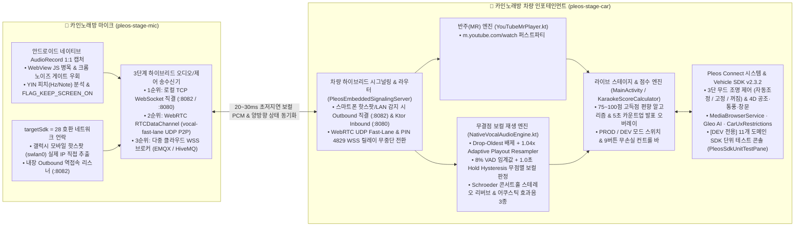

# 🎤 카인노래방 (Car in Karaoke)

> **별도의 하드웨어 마이크 없이 스마트폰 원터치 연결만으로 차량 실내를 초저지연 4D 콘서트홀 노래방으로 전환하는 Pleos Connect 전용 모빌리티 엔터테인먼트 앱**  
> **출품팀:** 팀카인노래방 (Team Car in Karaoke)

---

## 📋 공모전 제출 필수 안내 사항

### 1. 앱 이름 및 한 줄 소개
- **국문 앱 이름:** **카인노래방** *(동반 스마트폰 앱: **카인노래방 마이크**)*
- **영문 앱 이름:** **Car in Karaoke** *(동반 스마트폰 앱: **Car in Karaoke Mic**)*
- **한 줄 소개:** 별도의 블루투스 마이크 없이 스마트폰을 무선 마이크로 즉시 연결하여 **20~30ms 초저지연 보컬 스트리밍**과 **Pleos Vehicle SDK 기반 4D 콘서트홀 공간 연출(공조·통풍시트·무드조명·창문·스마트글래스 연동)**을 제공하는 차량용 노래방 솔루션입니다.

### 2. 실행 방법
1. **APK 설치:** 아래 [5. APK 파일 및 시연 영상 위치](#5-apk-파일-및-시연-영상-위치)에 배치된 서명된(Signed) Release APK 2종을 각각 차량 단말(AAOS 에뮬레이터)과 스마트폰(Android 기기 또는 에뮬레이터)에 설치합니다.
   ```powershell
   # 차량용 인포테인먼트 앱 (Pleos Connect AAOS 에뮬레이터 설치)
   adb -s emulator-5554 install -r --user current .\apk\팀카인노래방_카인노래방_release.apk

   # 스마트폰 무선 마이크 앱 (Android 스마트폰 또는 일반 에뮬레이터 설치)
   adb -s <스마트폰_또는_에뮬레이터_시리얼> install -r .\apk\팀카인노래방_카인노래방마이크_release.apk
   ```
2. **앱 실행 및 원터치 자동 페어링 (PIN `4829` / 핫스팟·IP 직결):**
   - 차량 디스플레이에서 **카인노래방**을 실행하고, 스마트폰에서 **카인노래방 마이크**를 실행한 뒤 마이크 권한을 허용합니다.
   - 동일 공유기 Wi-Fi 또는 스마트폰 모바일 핫스팟 연결 시 **앱 실행만으로 자동 탐색·연결(PIN `4829`)**되며, 차량 **[스마트 링크]** 탭에서 **스마트폰 IP 직접 입력** 또는 스마트폰 **[차량 연결]** 탭의 **[연결 시작]** 버튼으로도 즉시 연결됩니다.
3. **노래방 및 4D 무대 사용 방법:**
   - 차량 **[라이브 무대]** 또는 스마트폰 앱에서 **YouTube 노래방 MR 검색/추가** 및 스마트폰 **YouTube 앱 공유(`ACTION_SEND`)**로 선곡해 재생합니다.
   - 스마트폰에 대고 노래하면 차량 스피커로 초저지연 보컬과 콘서트홀 리버브가 출력되며, **[4D 공간 제어]** 탭과 **[사운드 · 리버브]** 탭에서 차량 하드웨어 연출(무드등·냉방·통풍·창문·암막 글래스) 및 키/템포/에코/점수 측정을 실시간 제어할 수 있습니다.

### 3. 테스트 환경 및 필요한 설정
- **필수 권한 설정 (`RECORD_AUDIO`):**
  - 스마트폰 **카인노래방 마이크** 최초 실행 시 실시간 음성 수음을 위한 **마이크 권한(`android.permission.RECORD_AUDIO`)** 허용이 필수입니다.
- **네트워크 연결 환경 (Zero-Config 3단계 자동 라우팅):**
  - **동일 Wi-Fi 또는 스마트폰 모바일 핫스팟 직결 (권장 · 20~30ms 초저지연):** 동일 공유기 Wi-Fi 또는 스마트폰 모바일 핫스팟(`swlan0`) 연결 시 앱 실행만으로 자동 탐색·연결(PIN `4829`)되며, 차량 **[스마트 링크]** 탭에서 스마트폰 IP 직접 입력으로도 로컬 TCP WebSocket(`:8082` / `:8080`)에 즉시 직결됩니다.
  - **서로 다른 네트워크 (유선랜 PC 에뮬레이터 ↔ LTE/5G 실제 스마트폰):** 인터넷만 연결되어 있으면 별도 공유기나 포트포워딩 없이 **WebRTC P2P(`vocal-fast-lane`) 및 클라우드 WSS 브로커(`EMQX` / `HiveMQ`)**로 자동 폴백되어 PIN `4829`로 즉시 연동됩니다.
  - **단일 PC 내 듀얼 에뮬레이터 오프라인 테스트 시 ADB 포트포워딩:** 외부 인터넷이 차단된 환경에서 동일 PC의 AAOS 에뮬레이터(`emulator-5554`)와 스마트폰 에뮬레이터를 로컬 직결할 경우 아래 명령어를 1회 실행합니다.
    ```powershell
    adb -s emulator-5554 forward tcp:8080 tcp:8080
    ```
- **Pleos Virtual Console (`http://127.0.0.1:8088`) 연동 방법:**
  - Pleos Connect 에뮬레이터 실행 후 호스트 PC에서 차량 센서·기어(`P`/`D`)·공조·조명·도어·시트 상태를 실시간 시뮬레이션하려면 아래 ADB 포트포워딩 명령어를 실행한 뒤 웹 브라우저에서 `http://127.0.0.1:8088`에 접속합니다.
    ```powershell
    adb -e forward tcp:8088 tcp:8088
    ```

### 4. 개발에 사용한 Pleos Connect 에뮬레이터 버전과 화면 규격
- **Pleos Connect 에뮬레이터 버전:** `Pleos Connect v2.1.0 (Android Automotive OS, API Level 34)`
- **차량 제어 SDK 버전:** `Pleos Vehicle SDK v2.3.2` (`ai.pleos.playground:Vehicle:2.3.2`)
- **화면 규격 및 레이아웃 대응:** Pleos Connect 표준 가로형 센터 디스플레이 규격 기준 설계 (AAOS 멀티윈도우 및 가로/세로 반응형 Split-View 레이아웃 완벽 지원)

### 5. APK 파일 및 시연 영상 위치
저장소 내 [`apk/`](./apk/) 폴더에 즉시 설치·실행 가능한 서명된 Release APK 2종이 배치되어 있으며, [`mov/`](./mov/) 폴더에 실제 시연 영상 2종이 포함되어 있습니다.
- **차량용 앱 (AAOS 인포테인먼트):** [`apk/팀카인노래방_카인노래방_release.apk`](./apk/팀카인노래방_카인노래방_release.apk)
- **스마트폰 마이크 앱 (Android):** [`apk/팀카인노래방_카인노래방마이크_release.apk`](./apk/팀카인노래방_카인노래방마이크_release.apk)
- **차량용 앱 시연 영상 (AAOS & Pleos 4D 연동):** [`mov/demo_car_aaos.mp4`](./mov/demo_car_aaos.mp4)
- **스마트폰 마이크 앱 시연 영상 (실시간 보컬 & 선곡·리모컨):** [`mov/demo_mic_mobile.mp4`](./mov/demo_mic_mobile.mp4)

---

### 🛠️ 소스코드 직접 빌드 명령어 (Release / Debug 분리 구성)

> **사전 빌드 환경 요구사항:** Android SDK `compileSdk = 37` (`pleos-stage-car` `targetSdk = 37`, `pleos-stage-mic` `targetSdk = 28`), Gradle Wrapper Daemon JVM 자동 프로비저닝(`pleos-stage-car`: JDK 25, `pleos-stage-mic`: JDK 21) 및 최초 빌드 시 Pleos 공식 Maven 저장소(`nexus-playground.pleos.ai`) 의존성 다운로드를 위한 네트워크 연결이 필요합니다.  
> **패키지 네임스페이스:** `io.github.teamcarinkaraoke.pleosstage.car` (차량용) / `io.github.teamcarinkaraoke.pleosstage.mic` (스마트폰용)

- **Windows (PowerShell / CMD) — 심사용 Signed Release APK 빌드 (`./apk/` 폴더 자동 갱신):**
  ```powershell
  .\pleos-stage-car\gradlew.bat -p pleos-stage-car :automotive:assembleRelease
  .\pleos-stage-mic\gradlew.bat -p pleos-stage-mic :androidApp:assembleRelease
  ```
- **macOS / Linux (Terminal) — 심사용 Signed Release APK 빌드 (`./apk/` 폴더 자동 갱신):**
  ```bash
  ./pleos-stage-car/gradlew -p pleos-stage-car :automotive:assembleRelease
  ./pleos-stage-mic/gradlew -p pleos-stage-mic :androidApp:assembleRelease
  ```
  *(개발자 진단 UI 및 SDK 단위 테스트 탭이 활성화된 개발용 빌드가 필요한 경우 `:automotive:assembleDebug`, `:androidApp:assembleDebug` 태스크를 실행합니다.)*

---

## 🏷️ Pleos App Market 등록 메타데이터 (공식 심사 규격 준수)

Pleos Connect 공식 다국어 리소스(`ko-KR` / `en-US`) 및 **앱 태그 표기 가이드(DOC 7)** 규격에 따른 마켓 등록 정보입니다.

| 항목 | 설정 값 | 비고 |
| :--- | :--- | :--- |
| **국문 앱 이름 (`values-ko`)** | **카인노래방** (스마트폰: **카인노래방 마이크**) | 한국어 시스템 로케일 적용 시 자동 노출 |
| **영문 앱 이름 (`values` / `values-en`)** | **Car in Karaoke** (스마트폰: **Car in Karaoke Mic**) | 기본 및 영어 시스템 로케일 적용 시 자동 노출 |
| **개발팀명** | **팀카인노래방 (Team Car in Karaoke)** | 공식 출품 팀명 |
| **앱 카테고리 (`appCategory`)** | `Music/Audio` (`android:appCategory="audio"`) | AAOS 미디어 센터 및 드라이빙 뷰 위젯 연동 |
| **필수 영문 태그 (Mandatory Tag)** | `Car in Karaoke` | 공식 가이드(DOC 7) 영문 앱 이름 필수 태그 |
| **국문 선택 태그 (Optional Tags)** | `카인노래방`, `노래방`, `차량노래방`, `스마트마이크` | 마켓 및 Gleo AI 한국어 검색 최적화 태그 |
| **Gleo AI 호출어 (`invokeWord`)** | `카인노래방` | `automotive/src/main/assets/schema.json` 정의 |

---

## 🏗️ 최신 하이브리드 오디오 & Zero-Config 통신 아키텍처

WebView 자바스크립트 스레드 병목·크롬 노이즈 게이트·다중 WebView 간 오디오 포커스 경합 문제를 근본적으로 해결하기 위해 **안드로이드 네이티브 `AudioRecord` 1:1 무손실 캡처**, **3단계 하이브리드 전송 우선순위 라우터**, **퍼스트파티 `<video>` 후킹 반주 엔진**, 그리고 **Kotlin 네이티브 Adaptive PCM 보컬/리버브 엔진**을 결합한 초저지연 아키텍처를 구축했습니다.



### 핵심 엔진 상세 스펙

1. **스마트폰 네이티브 `AudioRecord` 1:1 무손실 스트리밍 & `targetSdk = 28` 핫스팟(`swlan0`) 잠금 해제 (`AudioBridge.android.kt`)**
   - WebView JS 스레드 병목과 모바일 크롬의 공격적인 음성 노이즈 게이트(지속음 잘림 현상)를 우회하기 위해 안드로이드 네이티브 `AudioRecord`에서 직접 PCM 오디오 프레임을 1:1 무손실 캡처합니다.
   - `targetSdk = 28` 호환 모드를 적용해 안드로이드 상위 버전의 네트워크 인터페이스 접근 제한을 우회하고 갤럭시 모바일 핫스팟(`swlan0` / `ap0`)의 실제 로컬 IP를 직접 추출함으로써, 별도 공유기 없이도 차량과 **20~30ms 초저지연 다이렉트 직결**을 달성했습니다.

2. **3단계 하이브리드 전송 우선순위 라우팅 (`PleosEmbeddedSignalingServer.kt` ↔ `AudioBridge.kt`)**
   - **1순위 — 로컬 TCP WebSocket 직결 (`:8082` Outbound / `:8080` Inbound):** 동일 Wi-Fi, 모바일 핫스팟(`swlan0`), 에뮬레이터 브릿지 환경에서 스마트폰 역접속 리스너(`:8082`) 및 차량 내장 Ktor 서버(`:8080`)로 최우선 직결하여 패킷 손실 없는 초저지연 스트리밍을 보장합니다.
   - **2순위 — WebRTC `RTCDataChannel` (`vocal-fast-lane`, UDP P2P 직결):** 로컬 소켓 직접 개방이 제한된 NAT 환경에서는 STUN 기반 WebRTC `vocal-fast-lane`(`ordered: false, maxRetransmits: 0`) UDP P2P 채널을 자동 수립하여 Head-of-Line 블로킹 없이 실시간 보컬을 전송합니다.
   - **3순위 — 다중 클라우드 WSS 브로커 (`EMQX` / `HiveMQ`) 폴백:** 유선랜 데스크톱 PC ↔ LTE/5G 스마트폰처럼 완전히 분리된 이기종 망에서도 `wss://broker.emqx.io:8084/mqtt` 및 `wss://broker.hivemq.com:8884/mqtt` 다중 브로커 폴백을 통해 PIN `4829` 원터치 페어링과 원격 제어가 끊김 없이 유지됩니다.

3. **무결점 보컬 재생 엔진 (`NativeVocalAudioEngine.kt`)**
   - 지터 버퍼 누적 시 음절을 강제로 잘라내던 기존의 `Drop-Oldest` 샘플 절단 방식을 완전히 배제하고, 버퍼 수위가 임계치를 넘을 때만 **`1.04x` Adaptive Playout Resampler(선형 보간 기반 미세 배속 흡수)**를 가동해 피치 왜곡이나 팝 노이즈 없이 지연 시간을 자연스럽게 수렴시킵니다.
   - **8% VAD(Voice Activity Detection) 임계값 + 1.0초 Hold Hysteresis**를 적용해 숨소리·잔향 구간에서 보컬 활성 상태나 UI 인디케이터가 깜빡이지 않고 매끄럽게 유지됩니다.
   - 48kHz 스테레오 `AudioTrack` 상에서 **Schroeder 콘서트홀 리버브(4-Comb + 2-AllPass)**와 **어쿠스틱 물리 모델링 기반 고품질 효과음 3종(`박수`, `환호`, `탬버린`)**을 네이티브 합성하여 재생합니다.

4. **퍼스트파티 `<video>` 후킹 반주(MR) 엔진 (`YouTubeMrPlayer.kt`)**
   - YouTube IFrame Embed 재생 차단(Error 150/152)을 우회하기 위해 `m.youtube.com/watch` 퍼스트파티 모바일 페이지의 `<video>` 엘리먼트를 직접 제어하며, 차량 `[라이브 무대]` 또는 스마트폰 앱에서의 **YouTube 노래방 MR 검색/추가 및 스마트폰 YouTube 앱 공유(`ACTION_SEND`) 선곡**, 실시간 **48-Band 주파수 스펙트럼 추출**, 재생 배속(UI `0.80x ~ 1.20x` / 엔진 `0.75x ~ 1.25x`), 싱크 미세 보정(UI `±300ms` / 엔진 `±500ms`)을 지원합니다.

---

## 📁 프로젝트 구조

| 폴더명 | 모듈 역할 | 주요 기술 스택 |
| :--- | :--- | :--- |
| **`pleos-stage-car`** (`:automotive`) | **차량용 인포테인먼트 앱** (`카인노래방 / Car in Karaoke`) | Kotlin, Jetpack Compose, Pleos Connect Vehicle SDK (`v2.3.2`), `PleosSdkUnitTestPane`, `MediaBrowserService`, Ktor Embedded Server (`:8080`), Hybrid WSS/WebRTC/Outbound Bridge, `NativeVocalAudioEngine` (`1.04x` Adaptive Resampler), `KaraokeScoreCalculator` |
| **`pleos-stage-mic`** (`:androidApp`, `:shared`) | **스마트폰 무선 마이크 & 리모컨 앱** (`카인노래방 마이크 / Car in Karaoke Mic`) | Kotlin Multiplatform (KMP UI/상태 공통화, iOS `WKWebView` 기본 브릿지 지원) · **Android(`:androidApp`) 전용 네이티브 최적화:** `AudioRecord` 1:1 Streaming (`targetSdk 28` `swlan0` Hotspot Unlock), Outbound Listener (`:8082`), WebRTC `vocal-fast-lane` & WSS Relay, `FLAG_KEEP_SCREEN_ON`, 로컬 효과음 합성, YouTube `ACTION_SEND` 공유 연동 |
| **`pleos-stage-server`** | (선택/레거시) 외부 독립형 Node.js 중계 서버 | Express + Socket.IO(`:3000`) + Localtunnel 초기 프로토타입 서버 (현재는 차량 내장 Ktor 하이브리드 서버(`:8080`)가 기본 동작하므로 별도 구동 불필요) |

> **모듈 참고:** `pleos-stage-car`의 활성 AAOS 빌드 타겟은 `:automotive`(`settings.gradle.kts` 등록 모듈)이며, 하위 `pleos-stage-car/app` 디렉토리는 빌드에서 제외된 초기 레거시 코드 사본입니다.

---

## ✨ 주요 기능 및 Pleos Connect 심사 규격 반영 사항

### 1. 양방향 노래방 점수 시스템 (`KaraokeScoreCalculator`)
- 차량 라이브 스테이지 하단 바와 스마트폰 앱 어디서나 **`[🏆 점수 측정 ON / OFF]`** 상태를 실시간 양방향 동기화합니다.
- 실시간 마이크 수음 성량(Vocal Power)·음정 안정도(Pitch Accuracy)·곡 참여도(Stage Manner)를 누적 평가하는 **고득점 편향(75~100점) 응원형 알고리즘**을 적용했습니다.
- 곡 종료 시 차량과 스마트폰 화면에 동시에 **5초간 다이내믹 카운트업 점수 발표 오버레이**가 연출되며, **90점 이상 달성 시 피날레 무대 조명(`ENCORE_GOLD_FINALE`)과 환호·박수 효과음이 자동 연동**됩니다.

### 2. 차량 4D 공간 연출(3×2 그리드) · 조명 3단 제어 & 양방향 탐색(Seek)
- **탑승객 자동 감지 공조 & 3×2 공간 연출 그리드:** 좌석 착석 감지(`SeatOccupancy`) 기반 자동 통풍 시트 카드와 6대 공간 연출 타일(**`전 좌석 창문 닫기` · `암막 글래스 모드` · `실내 공기청정` · `쾌적 냉방 모드` · `공연 조명(무드등)` · `배터리 절전 모드`**)을 3×2 그리드로 제공하며, 배터리 20% 이하 시 절전 모드(조명 30% · 바람 1단)가 자동 발동됩니다.
- **무드등 3단 분리 제어:** 차량 앰비언트 라이트를 **`[자동조정(음악 연동)]` / `[밝기 고정(10~100%)]` / `[꺼짐(0%)]`** 3단계로 명확히 분리 제어하여 탑승자의 취향과 야간 주행 환경에 즉시 대응합니다.
- **양방향 실시간 구간 탐색(Seek) & 자유로운 선곡 연동:** 차량 스테이지와 스마트폰 미니 플레이어/리모컨 어디서나 프로그레스바 터치 및 드래그로 즉시 원하는 구간으로 이동(Seek)할 수 있으며, 차량 **[라이브 무대]** 또는 스마트폰 앱에서 **YouTube 노래방 MR 검색/추가** 및 스마트폰 **YouTube 앱 공유(`ACTION_SEND`)**로 선곡할 수 있습니다.

### 3. 스마트폰 무선 마이크 편의 기능 (`화면 켜짐 유지 ON/OFF` & YouTube 공유)
- **원터치 화면 켜짐 유지 (`FLAG_KEEP_SCREEN_ON`, Android):** 스마트폰을 마이크로 들고 노래하거나 리모컨으로 사용할 때 화면이 중간에 꺼지지 않도록 앱 실행 시 **`☀️ 화면 켜짐 유지 ON`**이 기본 활성화되며, 상단 헤더 토글 버튼으로 언제든 **`🌙 화면 자동 꺼짐`**으로 전환할 수 있습니다.
- **YouTube 앱 원터치 공유(`ACTION_SEND`, Android):** 스마트폰 YouTube 앱에서 원하는 노래방 MR 영상의 **[공유] → [카인노래방 마이크]**를 선택하면 즉시 차량 플레이리스트에 추가되고 무대가 시작됩니다.

### 4. Release(`PROD` 전용) / Debug(`DEV` 허용) 빌드 완벽 분리 & `[🧪 SDK 단위 테스트]` 콘솔
- **심사용 Release 빌드(`PROD` 고정) vs 개발용 Debug 빌드(`DEV` 허용):** `apk/` 폴더에 배포되는 공식 Release 빌드(`!BuildConfig.DEBUG`)에서는 소비자용 `PROD` 모드로 완전히 고정되어 `PROD | DEV` 전환 토글·개발자 배지·수동 서브넷 스캔 UI·진단 탭이 화면에서 원천 제거됩니다. 반면 개발용 `Debug` 빌드(`BuildConfig.DEBUG == true`)에서는 상단 `PROD | DEV` 전환 스위치와 개발자 진단 기능을 그대로 사용할 수 있습니다.
- **Debug 빌드 전용 `[🧪 SDK 단위 테스트]` 콘솔 (`PleosSdkUnitTestPane.kt`):** `Debug` 빌드의 `DEV` 모드 활성화 시 좌측 사이드바 5번째 탭이 열리며, **총 11개 Pleos Vehicle SDK `v2.3.2` 및 차량 시스템 도메인**(`1. Light`, `2. Window & SmartGlass`, `3. Door`, `4. HVAC 공조`, `5. Seat 시트/탑승감지`, `6. Driving & EV 배터리`, `7. Toll 하이패스`, `8. CarInfo & Display`, `9. TTS / STT 음성`, `10. CarUxRestrictions 주행규제`, `11. Gleo AI 인텐트`)의 `Capability` · `Get` · `Set` · 실시간 `Listener` 동작과 응답 지연(ms)을 원터치 배치/개별 실행으로 검증할 수 있습니다.

### 5. 사운드 프리셋 4종 & Pleos Connect 7대 차량 시스템 규격 준수
- **원터치 사운드 프리셋 & 2단 그룹 믹서:** `🎤 라이브 표준`, `🏛 콘서트홀`, `🗣 보컬 선명`, `🌙 야간 드라이브` 4종 프리셋과 `[음량 및 공간감 밸런스]` / `[곡 빠르기 · 키 · 싱크 조절]` 그룹 카드로 직관적인 사운드 튜닝을 지원합니다.
- **미디어 위젯 · 핸들 하드키 · 검색 재생 & 포그라운드 서비스 (`MediaBrowserService`):** AAOS 드라이빙 뷰 미디어 위젯 및 스티어링 휠 미디어 하드키 양방향 연동, 검색 기반 재생(`onPlayFromSearch`), 재생 중 `mediaPlayback` 포그라운드 서비스 전환(`ServiceCompat.startForeground`)을 완벽 지원합니다.
- **Gleo AI 음성 에이전트 (`assets/schema.json`):** `PLAY_KARAOKE_SONG`, `SET_STAGE_SOUND_MODE`, `CONTROL_STAGE_PLAYBACK` 인텐트 수신 및 `APP_ACTION_RESPONSE` 회신을 지원합니다.
- **주행 안전 인터락 (`CarUxRestrictions` & 기어 `D`) · AudioFocus Ducking · 멀티윈도우 · CCP Back 정책:** 주행 중 키보드 입력 및 수동 연결 설정 안전 잠금, 내비게이션 안내 시 30% 볼륨 Ducking, 가로/세로 분할 창 반응형 UI, CCP Back 키 백그라운드 전환(`moveTaskToBack(true)`) 정책을 완벽히 준수합니다.

---

<details>
<summary><b>고급 수동 포트포워딩 가이드 (오프라인 폐쇄망 전용)</b></summary>

인터넷이 완전히 차단된 오프라인 폐쇄망 환경에서 ADB 포트포워딩이나 수동 IP 입력이 필요한 경우에만 아래 설정을 사용하세요.

#### 1) 단일 PC 내 오프라인 ADB 포트포워딩 (`adb forward`)
```powershell
# 연결된 에뮬레이터 시리얼 확인
adb devices -l

# 호스트 PC 8080 포트 -> AAOS 차량 에뮬레이터 8080 포트 포워딩
adb -s emulator-5554 forward tcp:8080 tcp:8080
```

#### 2) USB 연결된 실제 스마트폰 오프라인 브릿지 (`adb reverse`)
```powershell
adb -s <차량_ADB_시리얼> forward tcp:8080 tcp:8080
adb -s <실제스마트폰_ADB_시리얼> reverse tcp:8080 tcp:8080
```

#### 3) Windows 폐쇄망 LAN 포트프록시 (`netsh interface portproxy`) 및 수동 IP 입력
```powershell
# 관리자 권한 PowerShell: 외부 LAN 유입(0.0.0.0:8080)을 로컬 127.0.0.1:8080으로 전달
netsh interface portproxy add v4tov4 listenaddress=0.0.0.0 listenport=8080 connectaddress=127.0.0.1 connectport=8080
netsh advfirewall firewall add rule name="PleosStage8080" dir=in action=allow protocol=TCP localport=8080
```
- 이후 차량 앱(`DEV` 모드)의 **[스마트 링크] → [DEV 와이파이 · 핫스팟 수동 코드 입력 및 서브넷 자동 스캔]** 또는 스마트폰 앱의 고급 수동 설정에서 직접 연결할 수 있습니다.

</details>
